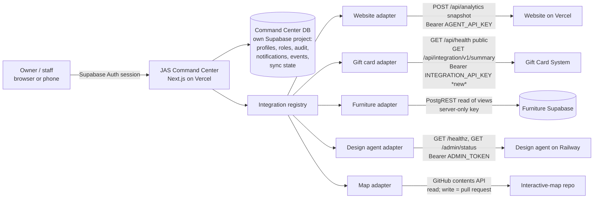

# JAS Command Center — Phase 1 discovery & integration inventory

Audited 2026-10-22 from the default branch of each repository (gift cards: the
Vercel production branch `claude/gift-card-system-build-0oflq7`). Everything
below is what the **code** says. Nothing was verified against a live system:
this build sandbox's network proxy refuses every JAS host
(`gift.justasecond.co.il`, `justasecond.co.il`, `map.justasecond.co.il`,
`*.vercel.app` all return `CONNECT 403`), so production state — which env vars
are set, which migrations ran, whether a service is up — is **unknown** and is
marked as such. No secret values were read or recorded.

Classification legend (used in every table):

| Code | Meaning |
| --- | --- |
| **REUSE** | Already implemented and reusable as-is |
| **SECURE** | Implemented, but needs a secure server-to-server integration (a key, a narrow endpoint, a scoped DB credential) |
| **MISSING** | Not implemented anywhere; must be built |
| **BLOCKED** | Blocked by missing credentials or external permissions |
| **UNSUPPORTED** | The provider / architecture does not support it |

---

## 0. Findings that change the brief

Read these first — four of the brief's assumptions do not match the code.

1. **The "WhatsApp bot" is not a customer-messaging bot.** `whatssup-bot` is the
   *JAS Design Agent*: an internal graphic designer the **owner** talks to on
   WhatsApp/Telegram (allowlisted numbers only — `WA_ALLOWED_NUMBERS`,
   `TELEGRAM_ALLOWED_USERS`), plus an optional "JAS AI Business OS" manager layer.
   There are no customer conversations, no human-handoff queue, no templates or
   24-hour-window logic, no lead pipeline from WhatsApp. A "customer
   conversation inbox", "assign to a human", "lead conversion" and "message
   templates" are therefore **UNSUPPORTED by the current bot** — they would be a
   new product (WhatsApp Cloud API customer messaging), not an integration.
   What *does* exist and is worth surfacing: job queue health, dead jobs, failed
   outbound messages, design projects/versions, approvals, automations, AI cost.
2. **The bot already contains a "Control Center" and a JAS AI manager**
   (`/cc`, `src/os/*`: specialist agents, approvals, automations, briefings,
   website agent, Instagram agent, quotes). It overlaps heavily with this
   project's AI-assistant and analytics scope. Building a second, independent AI
   operator would duplicate it. Decision needed (see §7).
3. **There are two gift-card sales paths.** The website checkout sells gift
   cards as cart lines (`netlify/functions/_checkout.ts`, ₪50–₪10,000, written to
   the website's `orders`), *separately* from the Gift Card System. Nothing links
   the two. Any "gift card revenue" figure must say which system it comes from,
   and website gift-card lines must never be added to Gift Card System sales.
4. **The Interactive Map is a neighbourhood route, not a project map.** It is a
   static GitHub Pages site (`map.justasecond.co.il`) listing 21 local businesses
   ("JAS Route" — cafés, studios, galleries) in `places-data.js`. It shares **no
   identifiers** with furniture-collection projects; there is nothing to link.
   Showing furniture projects on a map would need geocoded project addresses,
   which `projects` does not store (it has `city` only).

---

## 1. Repository inventory

| | Website & shop | Design agent ("WhatsApp bot") | Furniture collection | Interactive map | Gift cards |
| --- | --- | --- | --- | --- | --- |
| Repo | `just-a-second-website` | `whatssup-bot` | `Furniture-Collect` | `Interactive-map` | `gift_card_system` |
| What it does | Public bilingual site + shop, checkout, blog, manager panel (`/manager`) with products, orders, reviews, content, blog, marketing, BI insights | Owner-only design agent over WhatsApp/Telegram → branded PDFs; optional AI business OS + `/cc` control center | Field PWA: projects → buildings → entrances → apartments → items, photos, AI classification, collection, impact reports | Static Leaflet map of 21 partner places + walking route | Buy → deliver → redeem gift cards; admin, employee redemption console |
| Frontend | Vite + React 19 SPA (wouter), Tailwind | Server-rendered HTML for `/cc` | Vite + React 18 + TS, Tailwind/shadcn, PWA | Plain HTML + Leaflet 1.9.4 + OSM tiles | Next.js 14 App Router, Tailwind, Radix |
| Backend | Vercel functions (`api/*` wrapping `netlify/functions/*`) | Node 22 HTTP server, `node:sqlite`, durable job queue | Supabase (Postgres + RLS + 16 edge functions) | None | Next.js route handlers + server actions |
| Database | Supabase (own project) | SQLite file on a Railway volume (`/data`) | Supabase project `fdxqfwmtrqbaeqejynmu` | `places-data.js` in git | Supabase (own project; ref not in repo) |
| Auth | Supabase Auth + `admins` table + `is_admin()` | `ADMIN_TOKEN` (Bearer for `/admin/*`; login token for `/cc`), optional `CC_VIEWER_TOKEN` | Supabase Auth; `profiles.org_role` (ORG_ADMIN / PROJECT_MANAGER / WORKER) + `user_projects.project_role` (+VIEWER) | None (editor is a client-side file generator) | Supabase Auth + `user_roles` (owner/admin/store_manager/store_employee/finance) |
| Hosting | Vercel (also a `netlify.toml`; functions are Netlify-shaped, served by Vercel) | Railway (Docker), deploys from `main` | Vercel from `main` | GitHub Pages (`CNAME map.justasecond.co.il`) | Vercel, prod branch `claude/gift-card-system-build-0oflq7`, `gift.justasecond.co.il` |
| Payments | Grow via Make.com (`grow-webhook`, `?token=WEBHOOK_SECRET`) | — | — | — | Grow via Make.com (global Grow webhook) |
| Email | Resend | — | `send-invitation-email`, `weekly-digest` edge functions | — | SendGrid (free trial ended 2026-09-23, gotcha #21) |
| AI | Anthropic (copy, insights, product assistant), transcription | Anthropic + OpenAI (voice) | Anthropic/OpenAI via edge functions (classification, voice, search, statistics) | — | — |
| Analytics | First-party `analytics_events` + `MetricsSnapshot`; no GA4/ads | Cost tracking `os_usage` | Report KPIs (`src/lib/reports/kpis.ts`) | Google Analytics `G-0EM74CEJ0J` (no API access) | Admin stats (`getAdminStats`) |
| Scheduled jobs | Vercel cron 17:00 UTC → weekly BI email | Internal scheduler (automations, reminders, briefings) | `weekly-digest` edge function | — | Vercel cron deliver 09:00 + reconcile 06:00 UTC; GH Actions every 15 min + watchdog |
| Health endpoint | none | `GET /healthz` (public; 503 when jobs stuck) | none | none | `GET /api/health` (public, diagnostic) |

### Supabase topology

At least **three separate Supabase projects** — they do not share a database:
furniture (`fdxqfwmtrqbaeqejynmu`, from `supabase/config.toml`), website (a
different ref appears in `CONTINUE_ON_NEW_COMPUTER.md`), gift cards (ref only in
Vercel env). The bot uses SQLite. Cross-system joins are therefore impossible in
SQL; the command center has to join in its own layer, by identifiers it can
justify.

---

## 2. Architecture (target)

Rules this enforces: every source call is **server-side** (no source credential
reaches the browser); each adapter is isolated (one failing never blocks the
others); each adapter reports `not_configured` / `error` / `ok` with
`checkedAt` and latency, never "healthy" without a successful live probe.

### Dependency map

| From → to | Kind | Notes |
| --- | --- | --- |
| Bot → Website | `POST /api/analytics` snapshot (`WEBSITE_METRICS_TOKEN` = website `AGENT_API_KEY`) | Same contract the command center reuses |
| Bot → Website repo | GitHub PRs + Vercel deploys (website agent) | |
| Bot → Instagram, Wix | Graph API, Wix API (optional) | |
| Website → Grow (via Make) | payment links + `grow-webhook` | |
| Gift cards → Grow (via Make) | payment + global Grow webhook | Same Grow account as the website |
| Gift cards → SendGrid | delivery + event webhook | |
| Furniture → OpenAI/Anthropic | edge functions | |
| Map → OSRM, Nominatim, OSM tiles | public APIs, no keys | |

---

## 3. Available APIs (machine-usable today)

| System | Endpoint | Auth | Returns | Class |
| --- | --- | --- | --- | --- |
| Website | `POST /api/analytics` `{action:"snapshot", range, compare}` | `Bearer AGENT_API_KEY` (≥24 chars; read-only, snapshot only) | `MetricsSnapshot` v1: sessions, visitors, funnel, paid orders, verified/unverified revenue, payment failures, channels, devices, countries, products, JS/API/checkout errors, availability per KPI | **SECURE** (key may be unset) |
| Website | other analytics actions, products/orders writes | Supabase admin session | — | **SECURE** (needs a service account or new API) |
| Gift cards | `GET /api/health` | public | store, table counts, env flags, probes | **REUSE** |
| Gift cards | `GET/POST /api/cron/reconcile?notify=0` | `Bearer CRON_SECRET` | unmatched payments, paid-not-activated, undelivered, untracked charges, `needsAttention` | **SECURE** — usable read-only, but CRON_SECRET is a job-trigger secret; a dedicated key is better |
| Gift cards | stats, card search, resend, mark-paid, edit recipient | server actions behind Supabase session | — | **MISSING** as a machine API. Proposed: `GET /api/integration/v1/summary` reusing `getAdminStats()` + `getDeliveryHealth()` so no business logic is duplicated |
| Design agent | `GET /healthz` | public | job counts by status, stuck count, commit | **REUSE** |
| Design agent | `GET /admin/status`, `POST /admin/jobs/:id/retry`, `GET /admin/projects/:id` | `Bearer ADMIN_TOKEN` | jobs by type/status, dead jobs, failed outbound, recent design projects, brand history | **SECURE** |
| Design agent | `/cc/api/*` (overview, tasks, approvals, costs, automations, audit…) | cookie session from `/cc/login` | rich OS state | **SECURE** — cookie-only; a bearer variant would be a small PR |
| Design agent | `POST /api/events` | HMAC `X-JAS-Signature` (`OS_EVENTS_SECRET`) | ingests events from other systems | **REUSE** (lets the CC push events into the bot, if wanted) |
| Furniture | PostgREST on `projects`, `apartments`, `items`, views `project_summary_counts`, `project_material_rollups`, `apartment_item_counts`, `collector_stats` | Supabase key | everything | **SECURE** — views are `security_invoker`, so a service-role key or an ORG_ADMIN user session is needed |
| Furniture | edge functions (`calculate-statistics`, `weekly-digest`, …) | user JWT | | **SECURE** |
| Map | `places-data.js` via GitHub contents API | GitHub token (or public raw) | 21 places + 8 categories | **REUSE** read; write = PR |

---

## 4. Feature coverage matrix

### Executive overview
| Capability | Class | Source / note |
| --- | --- | --- |
| Website revenue (verified vs unverified), paid orders, sessions | **SECURE** | Website snapshot; needs `AGENT_API_KEY` |
| Gift card sales, liability, redeemed | **MISSING** (API) → **SECURE** | Needs the new summary endpoint (PR to gift_card_system) |
| Combined revenue | **MISSING** | Only website orders + gift card sales may be summed, and website gift-card lines must be excluded or labelled (finding #3). Website is ₪ decimal, gift cards are agorot — normalise to agorot |
| Furniture activity | **SECURE** | Furniture views |
| System health per project | **REUSE** for bot + gift cards (public health); **MISSING** for website, furniture, map (no health endpoint — probe the site URL / PostgREST instead) |
| Deployment status | **BLOCKED** | Needs Vercel API token (website, gift cards, furniture), Railway token (bot); GitHub Pages status via GitHub API |
| Real-time activity feed | **MISSING** | No source emits events to a central place. Options per source: furniture → Supabase Realtime/DB webhook; gift cards → new outbound webhook or poll; website → poll snapshot/orders; bot → poll `/admin/status`. Start with polling + ingestion table |

### Website & shop
| Capability | Class | Note |
| --- | --- | --- |
| Traffic, funnel, channels, devices, countries, campaigns, abandoned carts | **SECURE** | Snapshot has all of these, with `unavailable`/`partial` labels |
| Paid orders vs created vs checkout events | **SECURE** | Snapshot separates `orders` (paid statuses), `checkouts`, `statusBreakdown`, `pendingStale` |
| Refunds, tax, fees, profit | **UNSUPPORTED** | Not stored by the website (`null` in snapshot) |
| Product CRUD, prices, images, orders fulfilment | **SECURE** | Admin-only via Supabase RLS; needs a CC service path. Do **not** re-implement pricing — reuse website functions |
| Contact form submissions | **MISSING** | Contact page sends via email/change-request function; no table |
| Website errors | **SECURE** | `technical.jsErrors/apiErrors/checkoutErrors` in snapshot |
| Content publish workflow | **REUSE** concept | Bot's website agent already opens PRs |

### Design agent ("WhatsApp")
| Capability | Class | Note |
| --- | --- | --- |
| Customer inbox, assign to human, resolve, templates, opt-in, lead conversion | **UNSUPPORTED** | Not a customer bot (finding #1) |
| Queue health, dead jobs, retry a dead job | **SECURE** | `/admin/status`, `/admin/jobs/:id/retry` |
| Failed outbound messages | **SECURE** | `/admin/status.outbound_failed` |
| Design projects + versions | **SECURE** | `/admin/status.projects`, `/admin/projects/:id` |
| Automations, approvals, AI cost | **SECURE** | `/cc/api/*` (cookie auth) |
| Message volume analytics | **MISSING** | Tables exist (`inbound_messages`, `outbound_messages`) but no aggregate endpoint |

### Furniture collection
| Capability | Class | Note |
| --- | --- | --- |
| Projects, apartments, mapping/collection progress | **SECURE** | `projects` + `project_summary_counts` |
| Inventory search, photos, item edits | **SECURE** | `items` + storage. **Writes must respect the app's offline rules** (`shouldQueueWrite`) — edits from the CC to items a worker is editing offline will be detected as conflicts by the app's sync; CC writes should be limited and use `updated_at` concurrency |
| Impact (mass, diversion, CO₂) | **SECURE**, logic **REUSE** | `src/lib/reports/kpis.ts` is the only allowed definition. The CC must import/port nothing locally — either call a server function that runs it or link to `/reports/impact`. Planned vs confirmed diversion must stay separate; no landfill figure exists |
| Reports (PDF) | **REUSE** | Browser print of `/reports/impact`, `/reports/esg` — link out |
| Third-party handover | **REUSE** | `items.handover_confirmed_at` |

### Interactive map
| Capability | Class | Note |
| --- | --- | --- |
| List/search places, categories | **REUSE** | Parse `places-data.js` (as data, never `eval`) |
| Add/edit a place | **MISSING** → build | Today: editor downloads a file the owner commits by hand. CC can open a PR to `places-data.js` instead (review before publish) |
| Link to furniture projects | **UNSUPPORTED** | No shared identifiers or coordinates |
| Map analytics | **BLOCKED** | GA4 property `G-0EM74CEJ0J`, needs GA Data API credentials |

### Gift cards
| Capability | Class | Note |
| --- | --- | --- |
| Sold, sales revenue, active, redeemed, partial, liability, failed deliveries | **MISSING** API over **REUSE** logic | `getAdminStats()` already computes these correctly (`salesCards()` definition) |
| Reconciliation (paid-not-activated, undelivered, unmatched, untracked) | **SECURE** | reconcile endpoint |
| Search card, details (masked code), resend email, edit recipient, mark paid | **MISSING** API over **REUSE** logic | Server actions exist; expose through narrow authenticated endpoints, never re-implement redemption/activation |
| Refund/void | **SECURE** | `admin` role only in source |
| Processing fees | **UNSUPPORTED** | Not stored |
| Grow transaction listing | **BLOCKED** | No `GROW_*` API keys (gotcha #20) |

### Cross-cutting
| Capability | Class | Note |
| --- | --- | --- |
| Unified customer record | **BUILT in the command center** (`cc_contacts`, migration 0003; see `docs/CRM_INVENTORY.md`). Was: **MISSING**, mostly **UNSUPPORTED** | Only email links website orders ↔ gift-card buyers; the website stores email in plain text, gift cards too. Matching on normalised exact email is defensible for *display*, never for merging. Design-agent "contacts" are the owner only |
| Unified project record | **UNSUPPORTED** | Only furniture has projects |
| AI assistant with tools | **MISSING** here; exists in bot | See §7 |
| Notifications / email alerts | **MISSING** | Email needs a provider decision (website uses Resend, gift cards SendGrid) |

---

## 5. Security concerns found

| # | Where | Concern | Severity |
| --- | --- | --- | --- |
| S1 | gift cards | `/api/health` is public and reports env flags, table counts and provider names. Not secret, but useful reconnaissance | Low |
| S2 | gift cards | `/api/cron/*` accept any caller when `CRON_SECRET` is empty (by design, gotcha #11b). Reconcile is read-mostly; deliver is idempotent | Low/Med |
| S3 | website | Discount codes in publicly readable `site_content` (documented as open) | Med |
| S4 | website | The original `supabase-schema.sql` let anyone read every order (`using (true)`). `20261008_admin_auth_and_product_assistant.sql` replaces it with admin-only reads, and `…000200_security_followup.sql` drops public inserts — but `ANALYTICS.md` lists running those migrations as a manual step. **Confirm both ran in production**; if not, every customer's name/email/phone/address is public | High until confirmed |
| S5 | bot | `/cc` session cookie is `role.exp.hmac` — fine; `ADMIN_TOKEN` is a single shared secret for both admin API and owner login | Med |
| S6 | furniture | Rollup views needed `security_invoker` retrofits; any new view must set it | Info |
| S7 | all | Chat-shared secrets noted in gift_card CLAUDE.md as "to rotate" | Med |
| S8 | command center | Using a furniture **service-role** key bypasses RLS on a database holding worker data. Prefer a dedicated read-only Postgres role or a narrow `SECURITY DEFINER` RPC; service role is an interim choice |

---

## 6. Implementation blockers (credentials / permissions)

Each is an env var on the command center deployment unless stated.

| Integration | Needed | Who provides | Unblocks |
| --- | --- | --- | --- |
| Command center itself | A new Supabase project (`CC_SUPABASE_URL`, anon key, service role key) | Owner creates it | Login, roles, audit log, notifications, event store |
| Website | `WEBSITE_URL`, `WEBSITE_AGENT_API_KEY` (= website `AGENT_API_KEY`; set it on the website too if unset) | Owner (Vercel env) | All website analytics |
| Gift cards | `GIFT_CARDS_URL` (public health works with this alone); `GIFT_CARDS_INTEGRATION_KEY` after the source PR merges and the same value is set on the gift card deployment | Owner | Sales, liability, delivery problems |
| Furniture | `FURNITURE_SUPABASE_URL`, `FURNITURE_SUPABASE_KEY` (service role interim, or a read-only role) | Owner (Supabase dashboard) | Projects, progress |
| Design agent | `DESIGN_AGENT_URL` (Railway domain), `DESIGN_AGENT_ADMIN_TOKEN` | Owner (Railway) | Queue health, failures |
| Map | `GITHUB_TOKEN` (fine-grained: contents read on `Interactive-map`; contents+PR write for edits) | Owner (GitHub) | Places, edit-via-PR |
| Deploy status | Vercel API token + team/project ids; Railway API token | Owner | Deployment status per project |
| Map traffic | GA4 Data API service account | Owner | Map analytics |
| Grow | `GROW_API_KEY/SECRET` (gift cards) | Grow | Untracked-charge check |
| AI assistant | `ANTHROPIC_API_KEY` for the CC | Owner | Assistant |

---

## 7. Decisions for the owner

1. **AI assistant: extend the bot's JAS manager, or build in the command center?**
   The bot already has agents, approvals, audit and a cost budget. Recommended:
   build the CC assistant as a thin tool-calling layer over the CC's *own*
   adapters (so permissions and audit live in one place), and retire overlapping
   bot features later — but this is the owner's call.
2. **Customer WhatsApp inbox** is a new product (Meta Business verification,
   templates, consent, a separate number), not part of this integration.
3. **Which gift-card sales path is canonical** — website cart or Gift Card System.

---

## 8. What this iteration builds

See `README.md` → "Status". In short: the command center app foundation
(auth, RBAC, shell, design system, adapter layer, audit, health aggregation) and
read integrations for every source whose contract exists today, each showing a
precise "not configured — needs X" state until its credential is set.
